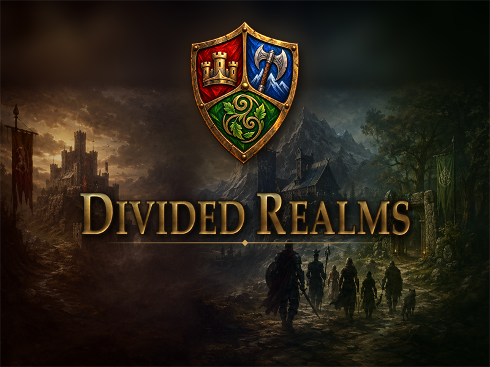
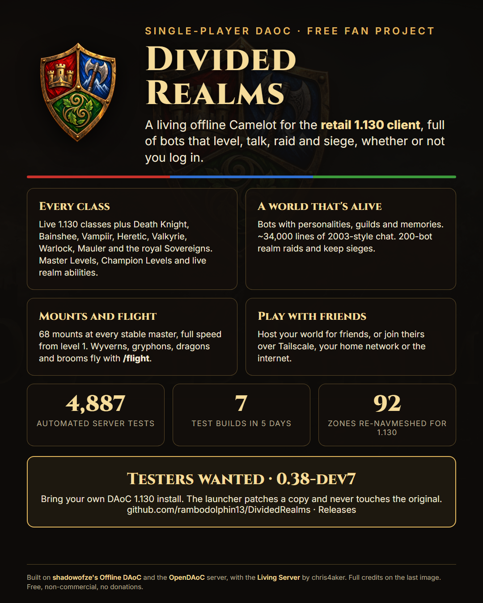
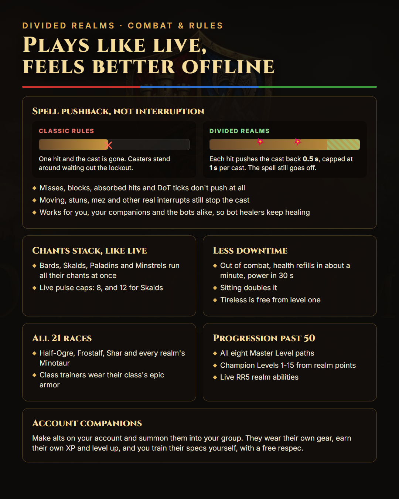
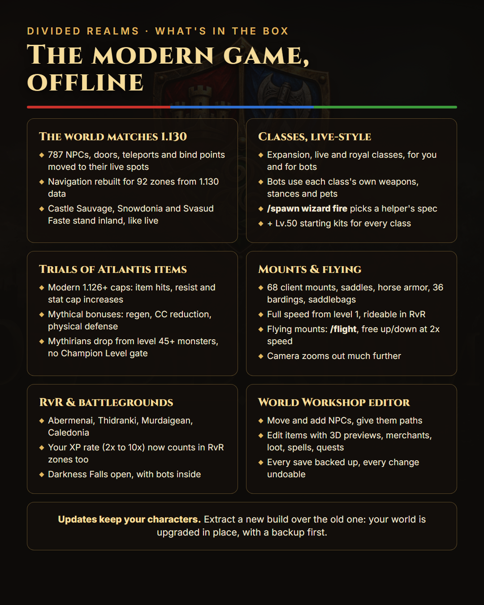
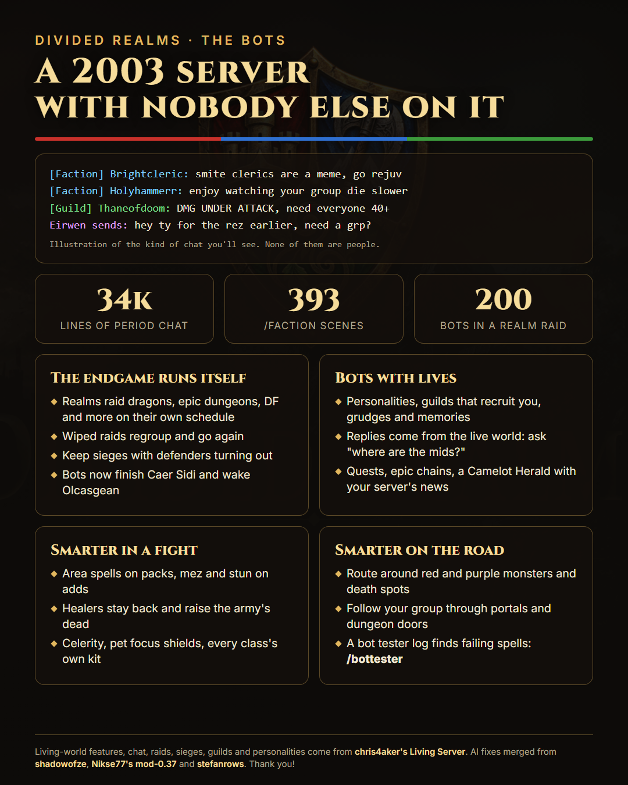
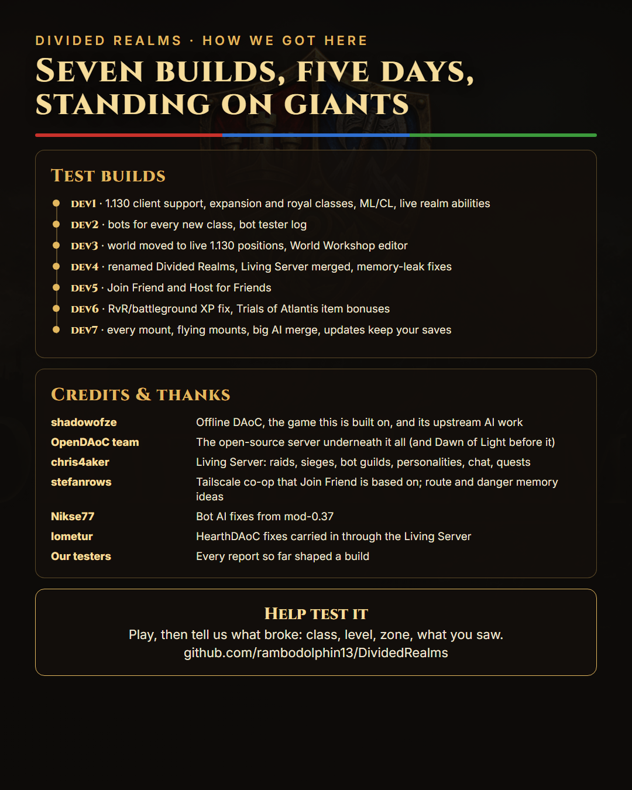

# Divided Realms

### A living, single-player Camelot for the retail 1.130 client

Divided Realms is a free, single-player Dark Age of Camelot world that runs on your own PC. You play with the
**original retail 1.130 client**, every modern class and race, and a world full of bots that level, talk, raid and
siege whether or not you log in. Bring friends along if you like: one of you hosts, the others join.

> **[Download the latest test build (0.38-dev8)](https://github.com/rambodolphin13/DividedRealms/releases/tag/v0.38-dev8-modern-test)**
> · [All releases](https://github.com/rambodolphin13/DividedRealms/releases)
> · [Report a bug](https://github.com/rambodolphin13/DividedRealms/issues/new/choose)
>
> **We're looking for testers.** These are development builds: the automated tests pass, but a lot of the newest work
> needs people playing it.

## At a glance

More pictures: the world, the bots, and how we got here

## What's in it

### The modern game, offline
- **The 1.130 client, unchanged on your disk.** The launcher copies your install and patches the copy.
- **The world matches 1.130:** 787 NPCs, doors, teleports and bind points moved to their live positions, and
  navigation rebuilt for 92 zones from 1.130 data.
- **Every class:** the live 1.130 classes plus Death Knight, Bainshee, Vampiir, Heretic, Valkyrie, Warlock, Mauler and
  the royal Storm, Pendragon and Tuatha Sovereigns ([details](docs/EXPANSION-CLASSES-MODERN-TEST.md)).
- **All 21 races**, Half-Ogre, Frostalf, Shar and the Minotaurs included ([details](docs/MODERN-RACES.md)).
- **Past level 50:** all eight Master Level paths, Champion Levels 1-15 and the live RR5 realm abilities
  ([Master Levels](docs/MASTER-LEVELS.md), [Champion Levels](docs/CHAMPION-LEVELS.md)).
- **Trials of Atlantis items** with the modern 1.126+ bonus caps and mythical bonuses. Mythirians drop from level 45+
  monsters, with no Champion Level gate.

### Combat that plays like live, and feels better offline
- **Spell pushback instead of interruption:** each hit adds 0.5 s to a cast, up to 1 s, and the spell still goes off.
  Misses, blocks, absorbed hits and damage-over-time ticks don't push. Moving, stuns and mez still interrupt
  ([details](docs/SPELL-CAST-PUSHBACK.md)).
- **Chants stack like live,** with the live pulse caps ([details](docs/MULTIPLE-CHANTS.md)).
- **Less downtime:** faster out-of-combat recovery, doubled while sitting, and Tireless free from level one.

### Mounts and flying
- Every stable master sells 68 mounts, realm saddles and horse armor, 36 bardings and four saddlebags, cheap.
- Any mount rides at full speed from level 1 and works in RvR zones.
- **Flying mounts:** wyverns, gryphons, dragons, brooms and more take off with `/flight`. The camera zooms out much
  further, too.

### A world that's alive
- Bots with personalities, guilds, memories and grudges, and about 34,000 lines of 2003-style chat with 393 /faction
  scenes. Ask "where are the mids?" and the answer comes from the live world.
- 200-bot realm raids on their own schedule, keep sieges with defenders that turn out, and bot raids that now finish
  Caer Sidi and wake Olcasgean.
- Bots for every class, using their class's own weapons, stances, pets, area spells and crowd control
  ([details](docs/BOT-MODERN-CLASSES.md)). `/bottester` shows which spells are failing for them
  ([details](docs/BOT-TESTER-LOG.md)).
- **Account companions:** summon the alts on your account into your group. They wear their own gear, earn their own
  XP, and you train their specs ([details](docs/ACCOUNT-COMPANIONS.md)).

### Tools
- **Play with friends:** *Host for Friends* opens your world to friends over Tailscale, your home network or the
  internet, and *Join Friend* plays on theirs ([guide](docs/PLAY-WITH-FRIENDS.md)).
- **World Workshop:** an editor in your browser for NPCs and their paths, items with 3D previews, merchants, loot,
  spells, quests and server settings. Every save is backed up and can be undone.
- **Updates keep your characters:** extract a new build over the old one, and your world is brought up to date in
  place, with a backup first.

## How to play

**You need:**
- Your own Dark Age of Camelot install at the **1.130** client version. The setup checks its `game.dll` and refuses
  any other build, so nothing is changed by mistake.
- The Windows feature **.NET Framework 3.5**, for the client's connector.
- About 7 GB of free disk space.

**Then:**
1. Download the zip from the [latest release](https://github.com/rambodolphin13/DividedRealms/releases/tag/v0.38-dev8-modern-test)
   and extract it.
2. Double-click **START DIVIDED REALMS.cmd**. The launcher asks for your DAoC folder, copies the client and patches the
   copy. **Your own install is not changed.**
3. Click **START SERVER**, then **ENTER REALM**. Your account is made on your first login.

**Updating:** close the launcher, extract the new build over your folder and replace every file. Your world and
characters are kept.

The full guide is [docs/PLAY-MODERN-TEST.md](docs/PLAY-MODERN-TEST.md).

## Found a bug?

Please [open a bug report](https://github.com/rambodolphin13/DividedRealms/issues/new/choose). The form asks for your
build, class, level, realm and zone, and what you saw. Logs from `runtime\server\logs` help a lot.

Not tested yet, so especially welcome:
- Joining a friend's world from a second PC.
- Every creature mount's saddle and barding look.
- The merged bot AI over a long session.

The rest is in [docs/KNOWN-ISSUES.md](docs/KNOWN-ISSUES.md).

## Credits and thanks

Divided Realms is made by [rambodolphin13](https://github.com/rambodolphin13), and it stands on the work of a lot of
other people:

| Who | What we use |
|---|---|
| [shadowofze](https://github.com/shadowofze/OfflineDAoC) | **Offline DAoC**, the game this project is built on: the server customizations, gamebots, companions, launcher and tools, plus its upstream AI work |
| [OpenDAoC](https://github.com/OpenDAoC/OpenDAoC-Core) (and Dawn of Light before it) | The open-source server underneath everything |
| [chris4aker](https://github.com/chris4aker/OfflineDAoC-LivingServer) | **Living Server**: realm raids, keep sieges, bot guilds, personalities, period chat, the living world and quests |
| [stefanrows](https://github.com/stefanrows/OfflineDAoC) | The Tailscale co-op that Join Friend is based on, and the route-bend and danger-memory ideas |
| [Nikse77](https://github.com/Nikse77) | Bot AI fixes from mod-0.37 |
| [lometur](https://github.com/lometur) | HearthDAoC fixes, carried in through the Living Server |
| [Eve of Darkness](https://github.com/Eve-of-Darkness/db-public) | The reference data for the expansion trainers and the trainers' epic armor |
| Our testers | Every report so far has shaped a build |

The code was written with AI tools (Claude), and directed and play-tested by the project owner. Licensed GPL-3.0, like
the projects it comes from; third-party licenses are in [THIRD_PARTY.md](THIRD_PARTY.md).

Looking for classic Offline DAoC (1.65 rules, Classic + Shrouded Isles, its own client download)? That's
[shadowofze's project](https://github.com/shadowofze/OfflineDAoC/releases).

## For developers

- **Start with** [AGENTS.md](AGENTS.md) (also read by Claude as [CLAUDE.md](CLAUDE.md)) for the project rules, then
  [docs/DEVELOPMENT.md](docs/DEVELOPMENT.md) for building and testing.
- **Where the code is:**
  - `source/server`: the game server and all bot AI.
  - `source/tools`: the launcher, World Workshop, the 1.130 client patcher and the release tools.
  - `source/new-client`: the Godot 4 client from Offline DAoC 0.37c.
- **What changed and when:** [CHANGELOG.md](CHANGELOG.md), [CHANGELOG-LIVING-SERVER.md](CHANGELOG-LIVING-SERVER.md)
  and [docs/PROGRESS-2026-10.md](docs/PROGRESS-2026-10.md).
- **Forking** is welcome. Keep the licenses and credits.

## Good to know

- **No game client is included.** You bring your own 1.130 install, and no download contains anyone's account,
  characters or saves.
- **Keep a backup of your save** before trying a new build. These are test builds, and there's no guarantee against
  regressions.
- **Local first:** hosting for friends is meant for people you know, not public servers.
- Divided Realms is an unofficial, free, non-commercial fan project. Dark Age of Camelot belongs to its owners, and
  this project is not affiliated with or endorsed by them.
